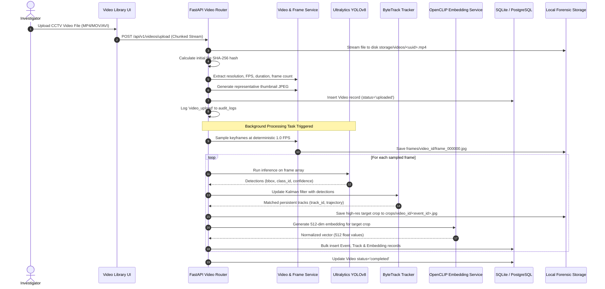
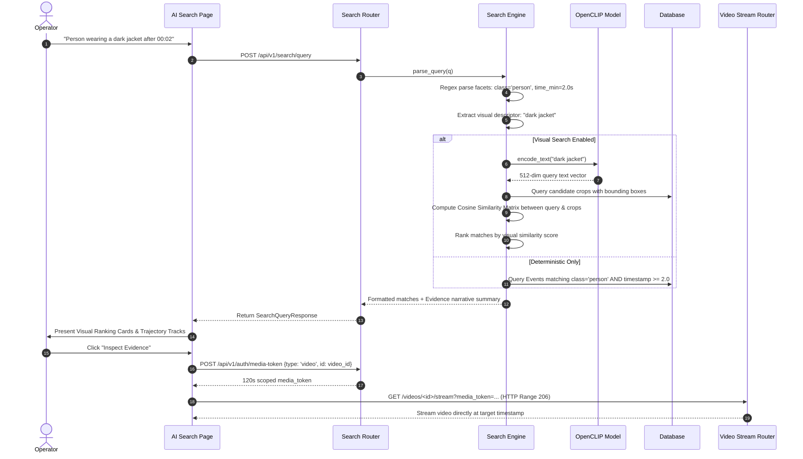
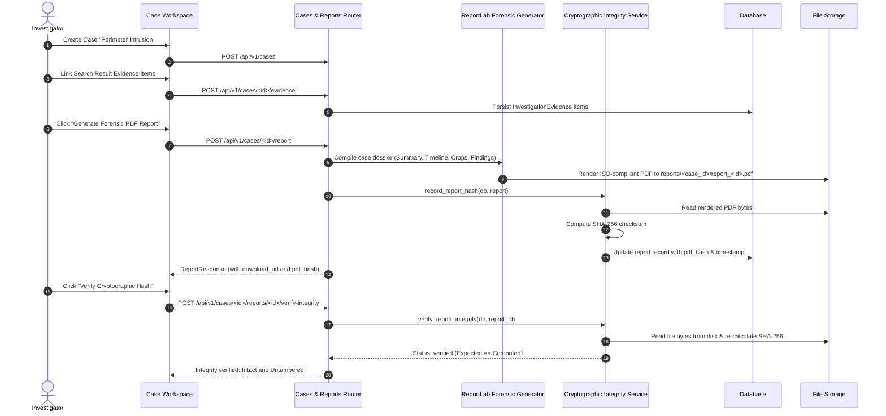

# VisionTrace AI — Enterprise CCTV Forensic Intelligence Platform

<p align="center">
  
  
  
  
</p>

---

## 1. Executive Summary & Overview

**VisionTrace AI** is an enterprise-grade AI-powered surveillance video investigation, forensic analytics, and incident intelligence platform. 

In traditional surveillance setups, investigators and security personnel spend dozens of hours manually scrubbing through hours of raw video to locate suspects, track vehicles, or compile court-admissible dossiers. **VisionTrace AI** automates this entire lifecycle:
1. **Automated Ingestion & Telemetry**: Ingests multi-camera CCTV footage, validates codec headers, and samples deterministic forensic keyframes.
2. **Object Detection & Continuous Multi-Object Tracking**: Runs real-time YOLOv8 object detection paired with ByteTrack Kalman-filter trajectory association to preserve subject identities across frames.
3. **Natural Language CCTV Search**: Translates conversational operator queries (e.g., *"Show cars between 00:00 and 00:05 with confidence above 80%"*) into deterministic spatiotemporal database queries.
4. **Multimodal Visual Similarity Search**: Uses OpenCLIP ViT-B-32 vision-language embeddings to rank targets based on unstructured appearance cues (e.g., *"Person wearing a dark jacket"*, *"White truck near perimeter"*).
5. **Investigation Case Management**: Groups discoveries into isolated evidentiary cases with chronological timelines, investigator notes, and multi-camera correlation.
6. **Forensic PDF Report Generation**: Automatically renders court-ready PDF incident dossiers with embedded keyframe crops, detection metrics, and executive summaries.
7. **Cryptographic Chain of Custody & RBAC**: Protects digital evidence using byte-level SHA-256 cryptographic hashing, dual-token authorization (short-lived scoped media tokens), role-based access control (Admin, Investigator, Reviewer, Viewer), and append-only audit logging.

---

## 2. System Architecture & High-Level Design

VisionTrace AI is built as a modular micro-service platform with clean boundaries between frontend client rendering, backend API gateway, asynchronous computer vision pipelines, database models, and evidence storage.

```
┌─────────────────────────────────────────────────────────────────────────────────────────────────┐
│                                 OPERATOR SURVEILLANCE CONSOLE                                   │
│                     React 19 • Vite • TypeScript • Tailwind CSS • Lucide Icons                  │
│   ┌───────────────────┬───────────────────┬───────────────────┬─────────────────────────────┐   │
│   │   Video Library   │   AI Deep Search  │   Investigation   │   Forensic Report Archive   │   │
│   │   & HTTP 206      │   (Facets + CLIP) │   Case Workspace  │   & SHA-256 Verification    │   │
│   └─────────┬─────────┴─────────┬─────────┴─────────┬─────────┴──────────────┬──────────────┘   │
└─────────────┼───────────────────┼───────────────────┼────────────────────────┼──────────────────┘
              │                   │                   │                        │
       Bearer Access Token        │           Bearer Access Token      Scoped Media Token
       (Axios Interceptor)        │           (Axios Interceptor)      (?media_token=... [120s])
              │                   │                   │                        │
┌─────────────▼───────────────────▼───────────────────▼────────────────────────▼──────────────────┐
│                                  FASTAPI APPLICATION GATEWAY                                    │
│                     Uvicorn • Pydantic v2 • SQLAlchemy 2.0 • Python 3.11+                       │
│  ┌────────────────────┬────────────────────┬─────────────────────┬───────────────────────────┐  │
│  │    Auth & RBAC     │   Search Engine    │   Case & Evidence   │     Integrity Engine      │  │
│  │  JWT • Bcrypt • JTI│  Regex AST + CLIP  │  Timeline & Notes   │ SHA-256 Sealing & Verify  │  │
│  └──────────┬─────────┴──────────┬─────────┴──────────┬──────────┴─────────────┬─────────────┘  │
└─────────────┼────────────────────┼────────────────────┼────────────────────────┼────────────────┘
              │                    │                    │                        │
┌─────────────▼────────────────────▼────────────────────▼────────────────────────▼────────────────┐
│                             COMPUTER VISION & FORENSIC PIPELINE                                 │
│  ┌─────────────────────┬─────────────────────┬──────────────────────┬────────────────────────┐  │
│  │   FFmpeg / OpenCV   │   Ultralytics YOLO  │      ByteTrack       │   OpenCLIP ViT-B-32    │  │
│  │  Metadata & 1.0 FPS │ Real Object Bounding│ Kalman Filter Motion │ 512-Dim Vision-Language│  │
│  │  Frame Extraction   │ Boxes & Confidences │ Multi-Frame Tracking │ Multi-Modal Embeddings │  │
│  └─────────────────────┴─────────────────────┴──────────────────────┴────────────────────────┘  │
└─────────────────────────────────────────────────────────────────────────────────────────────────┘
                                   │                              │
┌──────────────────────────────────▼──────┐   ┌───────────────────▼───────────────────────────────┐
│     DATABASE ENGINE (SQLAlchemy)        │   │          ENCRYPTED STORAGE SUBSYSTEM              │
│  • users (RBAC & last admin rules)      │   │  storage/                                         │
│  • videos (Metadata, SHA-256 hashes)    │   │  ├── videos/     (Raw MP4/MOV CCTV video feeds)   │
│  • tracks (ByteTrack persistent IDs)    │   │  ├── frames/     (1.0 FPS sampled keyframes)      │
│  • events (YOLO detections & boxes)     │   │  ├── crops/      (Target crops for visual search) │
│  • embeddings (512-dim CLIP vectors)    │   │  ├── reports/    (Generated court-ready PDFs)     │
│  • investigations & evidence items      │   │  └── thumbnails/ (Representative JPEG posters)    │
│  • audit_logs (Synchronous event trail) │   └───────────────────────────────────────────────────┘
└─────────────────────────────────────────┘
```

---

## 3. End-to-End Data Flow

### Flow 1: Video Ingestion, Detection & Tracking Pipeline


---

### Flow 2: Natural Language & Visual Search Flow


---

### Flow 3: Investigation Workflow & Court-Ready Report Generation


---

## 4. Key Architectural Modules

### 4.1. Real Detection & Multi-Object Tracking (Phase 4B)
- **Engine**: Ultralytics YOLOv8 for object localization and classification.
- **Tracker**: ByteTrack multi-object tracking.
- **Identity Association**: Detections across sampled frames are associated using spatial Kalman filters and bounding box Hungarian matching (IoU). The system assigns a persistent `track_id` so an individual walking across the camera view maintains identity continuity rather than appearing as separate detections.
- **Telemetry Extraction**: For every track, `start_time`, `end_time`, `start_frame`, `end_frame`, `confidence_avg`, and sequential `trajectory` coordinates are persisted.

### 4.2. Natural Language CCTV Search (Phase 5)
- **Deterministic Parsing**: Extracts structured facets without requiring expensive large language model latency for every filter:
  - **Object Classes**: Detects surveillance entities (person, car, truck, bus, bicycle, motorcycle, backpack, suitcase).
  - **Temporal Windows**: Parses natural syntax like `"between 00:00 and 00:05"`, `"after 10s"`, `"at 00:03"`.
  - **Confidence Thresholds**: Interprets `"above 80%"`, `"confidence > 0.75"`.
  - **Track Identifiers**: Parses direct track lookups like `"Track #2"`, `"track 5"`.

### 4.3. Multimodal Visual Similarity Search (Phase 6)
- **Model**: OpenCLIP ViT-B-32 trained on massive image-text pairs.
- **Representation**: Keyframe crops of detected objects are mapped into a 512-dimensional normalized vector space.
- **Ranking**: Unstructured visual appearance queries (e.g., *"Person in white shirt"*, *"Red vehicle"*) are embedded as text vectors. The system computes matrix cosine similarity between the query embedding and stored target crop embeddings, returning ranked visual candidates.

### 4.4. Court-Ready Incident Reports (Phase 7)
- **Engine**: ReportLab PDF Generation.
- **Layout**: Forensic dossier structure featuring:
  - Official Header & Case Reference UUID
  - Chain of Custody & Lead Investigator Attribution
  - Executive Incident Summary & Detector Findings
  - Chronological Evidence Timeline with visual thumbnails
  - Byte-Level Cryptographic Integrity Verification Box

### 4.5. Enterprise Security, RBAC & Integrity (Phase 8)
- **Role-Based Access Control (RBAC)**:
  - **Admin**: Full administrative privileges, user role management, system audit log review, all cases and videos.
  - **Investigator**: Upload video assets, create cases, link evidence, generate PDF reports, delete owned resources.
  - **Reviewer**: Assigned case auditing and review; read-only access to assigned cases, cannot mutate evidence.
  - **Viewer**: Read-only oversight of active surveillance assets.
- **Dual-Token Media Architecture**:
  - API endpoints require standard `Authorization: Bearer <jwt>` headers.
  - Native HTML elements (`<video src>`, ``, `<a download>`) cannot pass HTTP request headers. The platform provides `POST /api/v1/auth/media-token`, issuing 120-second single-use cryptographically signed tokens strictly scoped to the exact `resource_type` and `resource_id`.
- **Evidence Integrity Verification**:
  - Videos, evidence crops, and generated PDF reports are hashed using byte-level SHA-256 upon creation.
  - Live verification endpoints read the disk file and compare against the database seal, detecting byte-level tampering.
- **Audit Logging**:
  - Synchronous security event logging records every login, failure, video upload, deletion, evidence addition, report generation, and role alteration.

---

## 5. Technology Stack

| Layer | Technology | Version | Purpose |
| :--- | :--- | :--- | :--- |
| **Frontend Framework** | React | 19.3.1 | Core user interface library |
| **Build Tool & Bundler** | Vite | 8.3.5 | Ultra-fast HMR and production bundling |
| **Language (Client)** | TypeScript | 5.9.3 | Static type safety and data models |
| **Styling & UI System** | Tailwind CSS | 4.3.3 | Enterprise dark surveillance theme |
| **Icons & Visuals** | Lucide React | 1.16.0 | Tactical iconography |
| **State & Data Fetching** | TanStack Query | 5.90.21 | Server-state caching and synchronization |
| **Backend Framework** | FastAPI | 0.115.6 | Async REST API gateway |
| **ASGI Web Server** | Uvicorn | 0.34.0 | High-performance asynchronous server |
| **Language (Server)** | Python | 3.11+ | Backend application logic |
| **ORM & Database** | SQLAlchemy | 2.0.36 | Database abstraction and queries |
| **Database Migrations** | Alembic | 1.14.0 | Schema version control |
| **Primary Databases** | PostgreSQL / SQLite | 16 / 3.x | Relational storage & pgvector |
| **Computer Vision** | OpenCV (headless) | 4.10.0 | Video decoding, frame sampling, metadata |
| **Object Detection** | Ultralytics YOLOv8 | 8.3.48 | Deep learning object detection |
| **Multi-Object Tracking** | ByteTrack | 0.3.2 | Kalman filter trajectory association |
| **Multimodal AI** | OpenCLIP / PyTorch | 2.29 / 2.6 | Vision-language visual similarity |
| **PDF Dossier Engine** | ReportLab | 4.2.5 | Cryptographically sealed court reports |
| **Security & Cryptography** | PyJWT / Passlib / Bcrypt | Latest | JWT signing, Bcrypt hashing, SHA-256 |

---

## 6. Directory Structure

```
visiontrace-ai/
├── README.md                      # Unified in-depth project documentation
├── docker-compose.yml             # Container infrastructure (Postgres, Redis)
│
├── backend/                       # Python FastAPI Backend
│   ├── app/
│   │   ├── main.py                # FastAPI entry point & lifespan events
│   │   ├── api/
│   │   │   ├── deps.py            # RBAC, case scoping, and media token dependencies
│   │   │   ├── router.py          # Master API v1 route aggregator
│   │   │   └── routes/
│   │   │       ├── auth.py        # Authentication, JWT, media-token issuance
│   │   │       ├── videos.py      # Video upload, 206 streaming, frames, crops
│   │   │       ├── cases.py       # Investigation cases, evidence, reports archive
│   │   │       ├── search.py      # Natural language & CLIP visual search
│   │   │       ├── audit.py       # Cryptographic security audit log retrieval
│   │   │       └── health.py      # System health and hardware telemetry
│   │   ├── core/
│   │   │   ├── config.py          # Pydantic Settings & environment variables
│   │   │   ├── database.py        # SQLAlchemy engine and session factories
│   │   │   └── security.py        # Password hashing, JWT creation & decoding
│   │   ├── models/                # SQLAlchemy ORM database models
│   │   │   ├── user.py            # User credentials, roles, admin flags
│   │   │   ├── video.py           # Ingested videos & SHA-256 hashes
│   │   │   ├── track.py           # ByteTrack multi-object persistent tracks
│   │   │   ├── event.py           # YOLO detection instances and bounding boxes
│   │   │   ├── embedding.py       # 512-dim CLIP crop feature vectors
│   │   │   ├── investigation.py   # Cases, linked evidence, timeline notes
│   │   │   ├── report.py          # Generated reports & PDF checksums
│   │   │   ├── audit_log.py       # Append-only synchronous audit records
│   │   │   └── revoked_token.py   # Blacklisted JWT jti records
│   │   ├── schemas/               # Pydantic validation & response schemas
│   │   ├── services/              # Pure domain services
│   │   │   ├── video_service.py   # Video metadata, thumbnailing, frame sampling
│   │   │   ├── tracking_service.py# YOLO + ByteTrack execution engine
│   │   │   ├── search_service.py  # Regex parsing + CLIP cosine ranking
│   │   │   ├── embedding_service.py# OpenCLIP ViT-B-32 vector indexing
│   │   │   ├── report_service.py  # ReportLab PDF compilation engine
│   │   │   ├── integrity_service.py# Byte-level SHA-256 seal calculation & verify
│   │   │   └── audit_service.py   # Synchronous audit log recorder
│   │   └── tasks/                 # Background execution workers
│   ├── alembic/                   # Database migration versions
│   ├── tests/                     # Comprehensive test suite (58+ passing tests)
│   └── requirements.txt           # Python package dependencies
│
├── frontend/                      # React 19 + TypeScript + Vite Frontend
│   ├── src/
│   │   ├── App.tsx                # App root, React Query, AuthProvider, Router
│   │   ├── main.tsx               # DOM mounting
│   │   ├── index.css              # Dark surveillance design system & scrollbars
│   │   ├── components/
│   │   │   ├── ui/                # High-density buttons, cards, modals, badges
│   │   │   └── video/             # VideoPlayerModal (tactical player + overlays)
│   │   ├── context/
│   │   │   └── AuthContext.tsx    # Authentication state, login/logout, tokens
│   │   ├── pages/
│   │   │   ├── Dashboard.tsx      # System health, quick telemetry, video list
│   │   │   ├── VideoLibrary.tsx   # Video upload, cards/table views, status
│   │   │   ├── AISearch.tsx       # Discovery canvas, presets, CLIP ranking
│   │   │   ├── Investigations.tsx # Case management & dossier overview
│   │   │   ├── CaseWorkspace.tsx  # Timeline, evidence items, PDF generation
│   │   │   ├── ReportsPage.tsx    # Incident Reports & Forensic Archive
│   │   │   ├── AuditLogPage.tsx   # Immutable security audit trail
│   │   │   └── Login.tsx          # Tactical operator sign-in portal
│   │   ├── services/              # API HTTP clients (Axios + Token Injection)
│   │   └── types/                 # TypeScript interfaces and domain schemas
│   └── package.json               # Frontend dependencies & scripts
│
└── storage/                       # Local Evidence Storage
    ├── videos/                    # Uploaded CCTV video footage
    ├── frames/                    # Sampled 1.0 FPS keyframes
    ├── crops/                     # Target detection crops
    ├── thumbnails/                # Video poster previews
    └── reports/                   # Sealed PDF incident reports
```

---

## 7. Installation & Getting Started

### 7.1. Prerequisites
- **Node.js**: v20.x or higher + `pnpm`
- **Python**: v3.11 or higher
- **FFmpeg**: Required on system path for media decoding

### 7.2. Backend Setup
```bash
cd backend

# 1. Create and activate virtual environment
python -m venv venv
venv\Scripts\activate       # On Windows
# source venv/bin/activate  # On macOS/Linux

# 2. Install dependencies
pip install -r requirements.txt

# 3. Configure environment
cp .env.example .env        # Or edit .env directly

# 4. Apply database migrations
alembic upgrade head

# 5. Launch FastAPI development server
uvicorn app.main:app --reload --host 0.0.0.0 --port 8000
```
API Documentation will be live at: `http://localhost:8000/docs`

### 7.3. Frontend Setup
```bash
cd frontend

# 1. Install dependencies
pnpm install

# 2. Launch Vite dev server
pnpm dev
```
The Surveillance Console will be live at: `http://localhost:5173`

### 7.4. Default Credentials (Development Bootstrap)
When initialized for the first time, you can register or sign in using the configured administrative credentials:
- **Email**: `admin@visiontrace.ai`
- **Password**: `VisionTrace@Admin2026!`
- **Role**: `Admin`

---

## 8. Verification & Testing

VisionTrace AI includes an extensive automated test suite covering authentication, RBAC boundaries, single-tenant case isolation, last admin protection, media token scoping, YOLO/ByteTrack pipelines, CLIP embeddings, and SHA-256 evidence integrity.

```bash
# Run backend pytest suite
cd backend
python -m pytest tests/ -v

# Run frontend TypeScript type checking
cd frontend
pnpm tsc --noEmit

# Run frontend production build
cd frontend
pnpm build
```

---

## 9. Operator & Investigation User Guide

### 1. Ingesting Surveillance Footage
1. Navigate to **Video Library** in the sidebar.
2. Drag and drop CCTV files (MP4, MOV, or AVI up to 500 MB).
3. The platform validates video decodability, generates poster thumbnails, samples forensic keyframes at 1.0 FPS, computes initial SHA-256 checksums, and kicks off automated YOLOv8 + ByteTrack tracking.

### 2. Inspecting Detections & Tracking Overlays
1. Click any video card in the **Video Library** or **Dashboard**.
2. The **VideoPlayerModal** opens in dark surveillance mode.
3. Switch between **Telemetry** and **Targets** tabs to review identified pedestrians, cars, and persistent ByteTrack track IDs.
4. Toggle **YOLO Bounding Boxes: ON** to review visual bounding boxes directly on the filmstrip keyframes. Double-click any keyframe to inspect the full-resolution annotated frame.

### 3. Conducting Natural Language & Visual Search
1. Open **AI Search** from the sidebar.
2. Select an active CCTV feed or search across all video assets.
3. Type a query using either natural language facets or visual appearance cues:
   - *"Find all people detected in this video"*
   - *"Person wearing a dark jacket"*
   - *"Show me cars visible between 00:00 and 00:05"*
4. The system presents visual similarity matches with confidence ratings, target crops, and bounding boxes.
5. Click **"Inspect Evidence"** to launch the video player seeking directly to that exact second.

### 4. Compiling Cases & Generating Sealed PDF Dossiers
1. From any search result, click **"Add to Case"** (`FolderPlus`).
2. Select an existing case or create a new case (e.g., *"Perimeter Breach Incident #801"*).
3. Open **Investigations** in the sidebar and enter the case workspace.
4. Review the chronological evidence timeline, append investigator notes, and click **"Generate Forensic PDF Report"**.
5. The ReportLab engine compiles the incident dossier and permanently records its byte-level SHA-256 seal.
6. Verify the seal at any time by clicking **"Verify Cryptographic Hash"**.
7. Access all generated reports across cases centrally in the **Reports** archive (`/reports`).

---

## 10. Future Scope & Evolutionary Roadmap

While VisionTrace AI provides complete single-station investigation capabilities, the following enhancements represent the forward-looking roadmap:

### 1. Multi-Camera Spatiotemporal Re-Identification (ReID)
- **Current**: ByteTrack tracks subjects continuously within a single camera feed.
- **Future**: Integrate deep ReID feature extractors (e.g., OSNet / FastReID) to track the same individual across non-overlapping camera fields of view throughout a campus or facility.

### 2. Live RTSP / WebRTC Stream Ingestion
- **Current**: File-based chunked CCTV footage ingestion.
- **Future**: Real-time RTSP/ONVIF live stream decoding using hardware-accelerated GStreamer pipelines, enabling live perimeter breach alerts with sub-second latency.

### 3. Distributed Vector Scaling (pgvector & Milvus)
- **Current**: Bounded in-process cosine matrix ranking suitable for investigation datasets.
- **Future**: Direct integration with PostgreSQL `pgvector` HNSW indexes and Milvus clusters to support multi-million crop vector searches across city-scale camera networks.

### 4. Domain-Adapted Surveillance Vision-Language Models (VLM)
- **Current**: OpenCLIP ViT-B-32 general domain vision-language embeddings.
- **Future**: Fine-tune vision-language foundation models on surveillance domain datasets (e.g., thermal imaging, low-light IR, night vision, vehicle license plate OCR).

### 5. Hardware Security Module (HSM) & RFC 3161 Timestamping
- **Current**: Internal database SHA-256 hash sealing.
- **Future**: Bind forensic PDF reports and keyframes to an external RFC 3161 Trusted Timestamping Authority (TSA) or Hardware Security Module (HSM) for courtroom evidentiary certification.

---

## 11. License & Operational Compliance

VisionTrace AI is built in accordance with digital forensics and chain of custody guidelines outlined in **ISO/IEC 27037:2012** (*Guidelines for identification, collection, acquisition, and preservation of digital evidence*).

Licensed under the **MIT License**.
Copyright © 2026 VisionTrace AI. All rights reserved.
